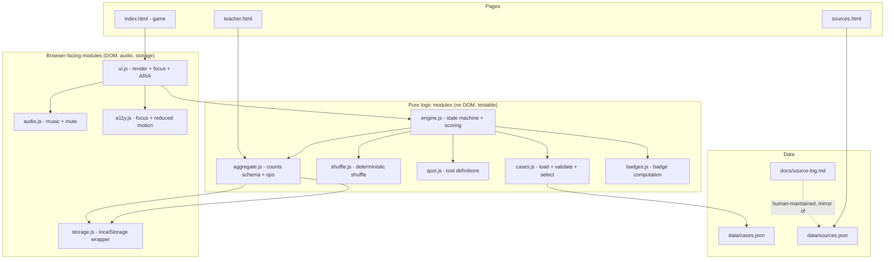
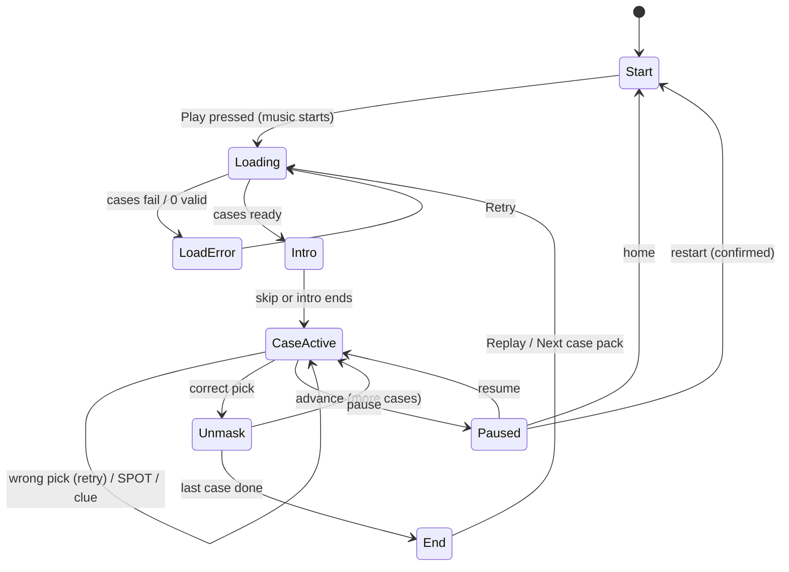

# Design Document

## Overview

AI Detective is a free, browser-based learning game for grades 6-8. A kid reads a short answer from a cartoon character (the Confident Bot), taps the one planted mistake hidden among 3-4 candidate phrases, and learns a four-step checking routine called SPOT. A run is 10 cases shown as stepping stones across a foggy river toward the detective agency HQ island.

This design keeps the existing static-site model. The game is plain HTML, CSS, and JavaScript, served as files with no build step and no backend. JavaScript is split into small ES modules (`<script type="module">`), which browsers load natively without any bundler, so deployment and hosting are unchanged (Requirement 1.1, 1.2).

The core design choices:

- **Pure logic, separate from the DOM.** Case validation, case selection, shuffling, scoring, clue cost, badge computation, and aggregate counting all live in pure modules that take data in and return data out. The DOM and audio layers call into them. This keeps the privacy and scoring rules verifiable with property-based tests that need no browser (Requirements 1, 2, 3, 5, 8, 9, 10).
- **No personal data, ever.** There is no account system, no free-text input, and no third-party script. The only thing stored is anonymous aggregate counts in `localStorage` (Requirement 9, 10).
- **Accessibility is a layer, not an afterthought.** Every screen is built from keyboard-operable controls with ARIA labels, non-color cues, WCAG AA contrast, reduced-motion support, and a 320-1920px responsive layout (Requirement 13).
- **Sources stay simple.** A small `data/sources.json` file is the single source of truth the Source Dashboard reads, and `docs/source-log.md` is the human-readable repo log. This avoids shipping a markdown parser to the browser on a no-build site (Requirement 11).

### Requirements coverage map

| Area | Requirements |
| --- | --- |
| Static site, data loading, validation | 1 |
| Case play, stepping stones, selection | 2 |
| Answer feedback, unmask, scoring | 3 |
| SPOT toolkit | 4 |
| Need a clue | 5 |
| Start screen, audio, pause | 6 |
| Intros, animation, skip, keyboard | 7 |
| End screen and certificate | 8 |
| Privacy | 9 |
| Teacher page and aggregate store | 10 |
| Source dashboard and source log | 11 |
| Content tone and reading level | 12 |
| Accessibility | 13 |

## Architecture

The game is a single-page app in `index.html` driven by a client-side state machine. Two more standalone pages, `teacher.html` and `sources.html`, read the same data and storage but have no game logic. The certificate is produced by the game page itself (a print-optimized view), so no extra page is required.



### Screen flow



### Why ES modules and no framework

Browsers load `type="module"` scripts directly from disk or a static host, with native `import`/`export` and no transpile step. That satisfies "no build step, no backend" (Requirement 1.2) while still letting us keep logic in small, independently testable files. A framework like React would need a bundler, so it is excluded.

## Components and Interfaces

All modules are ES modules. Pure modules export plain functions; browser-facing modules may touch `window`, `document`, `localStorage`, or `Audio`.

### `cases.js` — load, validate, select (Requirement 1)

```js
// Fetch with a 10s timeout; reject on timeout or parse error (1.3, 1.7).
export async function loadCases(url = "data/cases.json", timeoutMs = 10000): Promise<RawCase[]>

// Returns only cases that have every required field (1.8).
export function validateCases(raw: RawCase[]): Case[]

// Pick up to `n` valid cases, excluding ids in `exclude` (1.4, 1.5, 8.6).
// Returns [] only when no valid cases exist (1.6).
export function selectCases(valid: Case[], n = 10, exclude: string[] = []): Case[]
```

`selectCases` returns `min(n, valid.length)` cases. When `exclude` removes everything, the caller (Next case pack) resets `exclude` and selects again (Requirement 8.7).

### `shuffle.js` — deterministic shuffle (Requirement 2.2)

```js
// Fisher-Yates using an injected RNG so tests are reproducible.
export function shuffle<T>(items: T[], rng = Math.random): T[]
```

`rng` defaults to `Math.random` in production and a seeded generator in tests.

### `engine.js` — state machine and scoring (Requirements 2, 3, 5, 8)

The engine holds the run state and exposes pure transition functions. It never touches the DOM.

```js
export function createRun(cases: Case[]): RunState

// Returns { nextState, result } where result is "correct" | "wrong".
export function selectPhrase(state: RunState, phraseId: string): TransitionResult

export function useClue(state: RunState): RunState       // 5.2-5.5
export function advance(state: RunState): RunState        // 3.4, after unmask
export function isComplete(state: RunState): boolean      // last case solved
```

Scoring rules, all pure and all inside the engine:

- **Right answer points (3.3):** `points = max(BASE - wrongAttempts * STEP, MIN)` with `BASE = 100`, `STEP = 25`, `MIN = 1`. Points are clamped so they never drop below 1.
- **Clue cost (5.3-5.5):** first clue on a case subtracts 5; repeat clue on the same case subtracts 0 (`cluedCaseIds` set guards it). Score is floored at 0 (`score = max(0, score - cost)`).
- **No negative score anywhere (5.5):** every write to `score` passes through `clampScore(n) = max(0, n)`.

### `spot.js` — toolkit logic (Requirement 4)

```js
export const SPOT_TOOLS = ["step_away", "pick_words", "open_sources", "test_decide"];

// Returns the tip + neutral search phrase for a tool on a given case (4.2).
export function toolContent(aCase: Case, tool: SpotTool): { tip: string, searchPhrase: string }
```

Each tool activation calls `aggregate.recordSpotUse(tool)` through the engine (4.4). Tools can be used unlimited times and never advance the case (4.3, 4.6).

### `badges.js` — end-screen badges (Requirement 8.3)

```js
// One badge per mistake type the kid solved at least once in the run.
export function earnedBadges(state: RunState): Badge[]
```

### `aggregate.js` — anonymous counts (Requirements 4.4, 9.5, 10)

```js
export function emptyAggregate(): Aggregate
export function recordMiss(agg: Aggregate, mistakeType: MistakeType): Aggregate   // 10.1
export function recordSpotUse(agg: Aggregate, tool: SpotTool): Aggregate          // 10.2
```

`Aggregate` holds only integer counts keyed by fixed mistake-type and tool names. There is no place in the shape for an id, name, timestamp, or free text (Requirement 9.5).

### Browser-facing modules

- **`ui.js`** renders each screen, wires controls, and manages the DOM. It reads engine state and never mutates it directly. It keeps the `correct` phrase id in a module-scoped closure, not in a DOM attribute (see Candidate Phrase Selection below).
- **`audio.js`** owns a single `Audio` element, starts music only after the Play press, and toggles mute (Requirement 6).
- **`storage.js`** is the only module that touches `localStorage`. It serializes/deserializes the `Aggregate` and ignores unknown keys.
- **`a11y.js`** handles focus moves, the reduced-motion check (`matchMedia("(prefers-reduced-motion: reduce)")`), and skip behavior (Requirement 7, 13).

## Data Models

### Case (in `data/cases.json`)

A case holds the question, the full Confident Bot answer, the one planted-mistake phrase, 2-3 true decoy phrases taken from the same answer, SPOT content, and an optional source reference. Candidate phrases shown to the kid are `mistake.phrase` plus every entry in `decoys`, shuffled at render time (Requirement 2.2).

```json
{
  "id": "octopus-hearts",
  "topic": "animals",
  "question": "How many hearts does an octopus have?",
  "answer": "Great question! An octopus has three hearts. Two of them pump blood to the gills, and one pumps blood to the rest of the body. A whopping 97% of all octopuses use their biggest heart only while resting, trust me, I am 1,000% sure.",
  "mistake": {
    "phrase": "A whopping 97% of all octopuses use their biggest heart only while resting",
    "type": "extreme numbers",
    "why": "That exact 97% figure is made up; real sources do not give a number like that."
  },
  "decoys": [
    "An octopus has three hearts",
    "Two of them pump blood to the gills",
    "one pumps blood to the rest of the body"
  ],
  "spot": {
    "step_away": "Take a breath. A number that sounds too exact can be a trick.",
    "pick_words": "Try searching: how many hearts does an octopus have",
    "open_sources": "Check two kid-safe science sites and compare.",
    "test_decide": "If the sites agree and the bot's number is missing, the bot made it up.",
    "searchPhrase": "octopus number of hearts"
  },
  "sourceId": "octopus-hearts-src",
  "needsReview": false
}
```

Field rules (validated by `validateCases`, Requirement 1.8):

| Field | Required | Notes |
| --- | --- | --- |
| `id` | yes | unique string |
| `topic` | yes | kid-friendly category (2) |
| `question` | yes | shown to the kid (2.1) |
| `answer` | yes | full Confident Bot text (2.1, 12.3) |
| `mistake.phrase` | yes | exact substring of `answer` |
| `mistake.type` | yes | one of the four mistake types |
| `mistake.why` | yes | one sentence (3.2) |
| `decoys` | yes | 2-3 strings, each a true substring of `answer` |
| `spot` | yes | four tips + one neutral `searchPhrase` (4.2) |
| `sourceId` | optional | references `data/sources.json` (11.3) |
| `needsReview` | optional, defaults to `false` | set to `true` when any fact in the case is uncertain and still needs human review |

`mistake.type` is one of exactly: `"invented authority"`, `"extreme numbers"`, `"no specifics"`, `"overconfident tone"`.

A case is valid only if it has all required fields **and** `decoys.length` is 2 or 3, giving a total candidate count of 3 or 4 (Requirement 2.2). Cases failing any check are excluded (Requirement 1.8).

### RunState (in-memory, engine)

```js
RunState = {
  cases: Case[],            // 1-10 selected cases
  index: number,            // current case, 0-based
  score: number,            // >= 0 always
  perCase: {                // keyed by case id
    [caseId]: {
      wrongAttempts: number,
      solved: boolean,
      clued: boolean,         // clue already charged
      solvedTypesFirstTry: boolean
    }
  },
  solvedTypes: Set<MistakeType>,   // for badges
  aggregate: Aggregate            // mirrors localStorage
}
```

### Aggregate (in `localStorage`, key `aiDetective.aggregate.v1`)

```json
{
  "version": 1,
  "missesByType": {
    "invented authority": 0,
    "extreme numbers": 0,
    "no specifics": 0,
    "overconfident tone": 0
  },
  "spotUsage": {
    "step_away": 0,
    "pick_words": 0,
    "open_sources": 0,
    "test_decide": 0
  }
}
```

This shape has only a version number and integer counts under fixed keys. It holds no names, ids, device fingerprints, timestamps, or free text (Requirements 9.3, 9.5, 10.5).

### Source (in `data/sources.json`)

```json
[
  {
    "id": "octopus-hearts-src",
    "name": "Monterey Bay Aquarium — Octopus",
    "url": "https://www.montereybayaquarium.org/animals/animals-a-to-z/octopus",
    "dateAccessed": "2025-02-14",
    "companySource": false
  }
]
```

`docs/source-log.md` is the human-readable repo log and stays the canonical place a reviewer reads. `data/sources.json` is the machine-readable mirror the Source Dashboard loads. Keeping both avoids shipping a markdown parser to the browser on a no-build site (see Source Dashboard section).

### Candidate phrase selection UI (Requirement 2, 9.2)

Each case builds its candidate list as `[mistake.phrase, ...decoys]`, assigns each a random opaque token id at render time, and shuffles with `shuffle.js`. The mapping from token id to "is the mistake" lives only in the `ui.js` closure for the current case, never written into the DOM. Rendered buttons carry only the phrase text and a random token in `data-token`; nothing in the markup reveals which is correct, so a kid inspecting the page cannot read the answer off an attribute.

Each candidate is a native `<button>` with a visible text label and an `aria-label` (Requirement 2.4, 2.10, 9.2). Selection is handled by click and by Enter/Space (native button behavior), so no free-text field exists anywhere (Requirement 9.2).

On wrong pick: the button gets an `aria-pressed`/`.is-wrong` state with a non-color icon (an X glyph) plus color, the case stays active, and a retry control re-enables selection (Requirements 2.9, 3.5, 3.6). On correct pick: the button shows a check glyph plus color, the Confident Bot unmasks, and the case is marked solved (Requirements 2.8, 3.1).

## Correctness Properties

*A property is a characteristic or behavior that should hold true across all valid executions of a system — essentially, a formal statement about what the system should do. Properties serve as the bridge between human-readable specifications and machine-verifiable correctness guarantees.*

These properties target the pure logic modules (`cases.js`, `engine.js`, `shuffle.js`, `spot.js`, `aggregate.js`, `badges.js`) plus content checks over `data/cases.json` and UI copy. They do not cover visual contrast or layout, which require tooling and manual audit (see Testing Strategy).

### Property 1: Selection count equals the available minimum

*For any* list of valid cases and target count `n`, `selectCases` returns exactly `min(n, validCount)` cases, and returns an empty list only when no valid cases exist.

**Validates: Requirements 1.4, 1.5, 1.6**

### Property 2: Validation keeps only complete cases

*For any* list of raw cases with randomly present or missing required fields, every case returned by `validateCases` has all required fields and a `decoys` length of 2 or 3, and no case missing a required field appears in the output.

**Validates: Requirements 1.8**

### Property 3: Candidate structure is 3-4 with exactly one mistake

*For any* valid case, the built candidate list has a length of 3 or 4, exactly one candidate corresponds to the planted mistake, and the rest correspond to true decoy phrases.

**Validates: Requirements 2.2**

### Property 4: No free-text input on any screen

*For any* screen rendered by the game, teacher page, or source dashboard, the resulting DOM contains zero free-text input controls (no `<input type=text/email/...>`, `<textarea>`, or `contenteditable`).

**Validates: Requirements 2.5, 9.2**

### Property 5: Question counter matches progress

*For any* run and any reachable case index `i`, the displayed counter value equals `i + 1` and lies within 1 to the run length (at most 10).

**Validates: Requirements 2.6**

### Property 6: Correct pick solves, wrong pick retains the case

*For any* valid case, selecting the planted-mistake phrase marks the case solved, and selecting any non-mistake phrase increments wrong attempts, leaves the case unsolved, and does not advance the case index.

**Validates: Requirements 2.8, 2.9, 3.5, 3.6**

### Property 7: Award points are bounded and non-increasing in wrong attempts

*For any* non-negative wrong-attempt count, the points awarded for a correct pick are between 1 and 100 inclusive, and the awarded points never increase as the wrong-attempt count increases.

**Validates: Requirements 3.3**

### Property 8: Score is always a non-negative integer

*For any* sequence of correct picks, wrong picks, and clue uses, the score after every operation is an integer greater than or equal to 0.

**Validates: Requirements 2.7, 5.5**

### Property 9: Clue is charged at most once per case

*For any* case, the first clue use subtracts `min(5, currentScore)` from the score and any later clue use on the same case subtracts nothing, while always revealing the mistake type and never revealing which candidate is the mistake.

**Validates: Requirements 5.2, 5.3, 5.4**

### Property 10: SPOT content is present and within length

*For any* valid case and any of the four SPOT tools, `toolContent` returns a non-empty tip of at most 160 characters and a non-empty neutral search phrase.

**Validates: Requirements 4.2**

### Property 11: SPOT use never advances and counts exactly once

*For any* case and any number of SPOT activations, the case index and solved flag are unchanged, and each activation increases exactly the matching tool's aggregate count by 1 while adding no new key to the aggregate.

**Validates: Requirements 4.3, 4.4, 4.6**

### Property 12: Aggregate store holds only anonymous counts

*For any* sequence of `recordMiss` and `recordSpotUse` operations starting from an empty aggregate, the serialized store contains exactly the allowed keys (`version`, `missesByType` with the four fixed mistake types, `spotUsage` with the four fixed tools) and every leaf value is a non-negative integer, with no identifier, name, timestamp, or free-text field ever present.

**Validates: Requirements 9.3, 9.5, 10.5**

### Property 13: Badges match the set of solved mistake types

*For any* run, `earnedBadges` returns exactly one badge for each distinct mistake type solved at least once (no duplicates, none for unsolved types), and every badge label is 60 characters or fewer.

**Validates: Requirements 8.3**

### Property 14: Next case pack excludes played cases

*For any* set of played case ids and a larger pool of valid cases, the cases selected for a Next case pack run have ids disjoint from the played set.

**Validates: Requirements 8.6**

### Property 15: Resume restores the run exactly (round-trip)

*For any* run state, taking a pause snapshot and then restoring it yields a run state deep-equal to the original, including the current case and score.

**Validates: Requirements 6.7**

### Property 16: Mute then unmute restores audio state (round-trip)

*For any* audio state, muting and then unmuting returns the audio to its prior state.

**Validates: Requirements 6.10**

### Property 17: Feedback and instruction copy is neutral and plain

*For any* instruction or feedback string shown to the kid (including each case `mistake.why` and each case's SPOT tip strings), the text contains none of a defined blocklist of shaming or second-person-blame words, every sentence has 15 words or fewer, and the Flesch-Kincaid grade level is 8.0 or lower.

**Validates: Requirements 3.7, 12.1, 12.2, 12.5**

### Property 18: Confident Bot answers are confident but never insulting

*For any* case answer, the text contains at least one confident-tone marker and zero words from the insult blocklist.

**Validates: Requirements 12.3**

### Property 19: Explanation screens stay within the word budget

*For any* explanation screen content, the word count is 120 or fewer.

**Validates: Requirements 12.4**

## Error Handling

| Condition | Handling | Requirement |
| --- | --- | --- |
| `cases.json` fetch exceeds 10s or network fails | Reject the load promise; show a load-failure message and a Retry control; keep any previously loaded cases in memory | 1.3, 1.7 |
| `cases.json` is not valid JSON | Catch the parse error; show the same load-failure + Retry screen; do not start the run | 1.7 |
| Cases loaded but 0 pass validation | Show a "no cases available" message and a Retry control; do not start the run | 1.6 |
| A case is missing required fields | `validateCases` excludes it and selection continues from the rest | 1.8 |
| A SPOT tool tip cannot be shown | Keep the case active, show a "tip unavailable" message, do not submit or advance | 4.5 |
| Clue would drop score below 0 | Clamp score to 0 | 5.5 |
| `localStorage` unavailable or throws (private mode, quota) | `storage.js` catches, logs to console only, and the game runs with an in-memory aggregate so gameplay is never blocked; the teacher page shows the empty-state | 10.5, 10.7 |
| `sources.json` missing or unreadable | Source Dashboard shows a "sources unavailable" message | 11.4 |
| `sources.json` is an empty array | Source Dashboard shows an empty-state message | 11.5 |
| A case has `needsReview: true` | Source Dashboard (and the review checkpoint before cases ship) flags the case for human follow-up instead of silently publishing it; the case is not excluded from play on that basis alone | 11.4 |
| Aggregate store has no recorded plays | Teacher page shows an empty-state message, not zeroed sections | 10.7 |

All error screens use the same accessible pattern: a heading, a plain-language message (grade 5-7, Requirement 12.1), and a keyboard-focusable control, with focus moved to the message on display.

Untrusted-content note: `cases.json` and `sources.json` are repo-controlled, but the renderer still treats all case text as data and inserts it with `textContent` (never `innerHTML`) so a stray `<` in content can never inject markup.

## Testing Strategy

### Approach for a no-build static site

Tests must not add a build step or change deployment (Requirement 1.2). The strategy uses two layers:

1. **In-browser test harness (no install, no build).** A `tests/index.html` page imports the pure modules directly as ES modules and runs a tiny assertion runner plus a vendored, single-file property-testing helper (a small `fast-check`-style generator-and-shrink utility committed to `tests/vendor/`). Opening `tests/index.html` in any browser runs every unit and property test and prints pass/fail. This ships nothing to the game and needs no tooling.
2. **Optional zero-config CI run.** The same test files can run headless with a zero-config runner invoked on demand (for example `npx vitest run` or `npx web-test-runner`) without being part of the site build or deployment. This is for CI only; the deployed artifact stays the three-plus-data static files.

Because every property targets pure functions, the harness never needs a real network, real audio, or `localStorage` — those are injected as fakes.

### Property-based tests

- Use the vendored property-testing helper. Do not hand-roll shrinking or implement PBT from scratch.
- Each property test runs a **minimum of 100 iterations**.
- Each property test is tagged with a comment in the form: **Feature: ai-detective, Property {number}: {property_text}**.
- Each correctness property (1-19) is implemented by a **single** property-based test.
- Generators: a `caseGen` producing valid and deliberately-broken cases (random dropped fields, decoy counts 0-5), a `runGen` producing run states with random pick/clue/SPOT histories, an `aggregateOpsGen` producing random sequences of `recordMiss`/`recordSpotUse`, and a `copyGen` drawing from the actual UI copy and `cases.json` content for the tone/readability properties (17, 18, 19).
- The shuffle RNG is seeded in tests so candidate-structure checks are reproducible.

### Unit (example) tests

Focused examples for behavior that is not a universal property:

- Load flow: slow/failed/invalid fetch shows the error + Retry and preserves prior cases (1.3, 1.7); `selectCases([])` returns `[]` and triggers the no-cases screen (1.6).
- Candidate control responds to click, Enter, and Space (2.4); the correct phrase id is not present in any DOM attribute.
- Unmask shows the mistake type and one-sentence why (3.1, 3.2); right/wrong each render a text label plus an icon/shape, distinguishable without color (3.8).
- Audio: no `play()` before the Start interaction (6.3); `play()` called after Play (6.2).
- Pause menu offers mute/resume/restart/home; restart asks for confirmation (6.6, 6.8).
- End screen shows exactly three controls with labels (8.4); Replay reuses the pack (8.5); Next pack with everything excluded resets to the first pack (8.7, 8.7 edge case).
- Certificate view has an empty name line and no pre-filled name; no name key is written to storage (8.8, 8.9).
- No auth controls on any screen (9.1); no external script `src` in any page (9.4).
- Teacher page renders known aggregate totals (10.1, 10.2) and an empty-state for an empty aggregate (10.7), with the single-device disclosure visible (10.6).
- Source dashboard renders a known `sources.json` (11.1), an unavailable message when the fetch fails (11.4), and an empty-state for `[]` (11.5).
- Reduced-motion: with `prefers-reduced-motion` mocked, intros show end state and skip stops within budget (7.2, 7.3, 13.7).
- Default run sets no timer (13.3).

### Integration and manual checks (not property tests)

- WCAG AA contrast (13.1): automated contrast tooling plus a manual pass with a screen reader, since contrast depends on rendered CSS, not logic.
- Responsive 320-1920px with no horizontal scroll (13.8): viewport/layout checks and manual review on a Chromebook-sized viewport.
- Full keyboard playthrough and visible focus order (7.4, 7.5, 7.6, 13.5): manual keyboard-only run of a complete 10-case game.
- Privacy network check (9.4): load the game with the browser network panel open and confirm requests go only to same-origin files (`cases.json`, `sources.json`, audio), with zero third-party analytics/ad/tracking domains.

## File and Project Structure

Reuses the existing static-site setup; no build tooling is added.

```
index.html            # Game page (Start -> Loading -> Intro -> Cases -> End + certificate view)
teacher.html          # Anonymous class-wide totals (reads aggregate store)
sources.html          # Source dashboard (reads data/sources.json)
styles.css            # Shared styles: screens, stepping-stone river, WCAG AA tokens, print styles for the certificate
js/
  main.js             # Entry for index.html: boots UI + engine
  ui.js               # DOM render, focus, ARIA, candidate buttons (holds correct-id in closure)
  engine.js           # Pure state machine + scoring
  cases.js            # Pure load + validate + select
  shuffle.js          # Pure deterministic shuffle
  spot.js             # Pure SPOT tool definitions + content
  badges.js           # Pure badge computation
  aggregate.js        # Pure aggregate ops + schema
  storage.js          # localStorage wrapper (only module touching storage)
  audio.js            # Music + mute (only module touching Audio)
  a11y.js             # Focus moves, reduced-motion, skip
  teacher.js          # Entry for teacher.html
  sources.js          # Entry for sources.html
data/
  cases.json          # Pre-written, human-reviewed cases (12-15 for MVP)
  sources.json        # Machine-readable source list for the dashboard
docs/
  source-log.md       # Human-readable canonical source log (repo)
tests/
  index.html          # In-browser test harness (open to run all tests)
  *.test.js           # Unit + property tests importing the pure modules
  vendor/pbt.js       # Vendored single-file property-testing helper
assets/
  audio/              # Background music file(s)
```

The current `script.js` is replaced by the `js/` modules; `index.html` and `styles.css` are rebuilt for the game. The certificate is a print-styled section of `index.html` shown by the End screen's Download certificate control (via the browser print dialog), so no separate certificate page or PDF library is needed, keeping the no-build constraint (Requirements 8.8, 1.2).

### Source dashboard data decision

The dashboard reads `data/sources.json` rather than parsing `docs/source-log.md` in the browser. Reasoning: on a no-build static site, shipping and maintaining a markdown parser client-side adds weight and a failure mode for the sake of reformatting content we already control. A small JSON file is trivial to `fetch` and render, is easy to validate, and keeps `source-log.md` as the clean human-readable log reviewers expect (Requirement 11.2). The two are kept in sync when a source is added; the source-log remains the canonical repo record (Requirements 11.1, 11.3).

## Design Decisions and Rationale

- **Pure core + thin shells.** Putting scoring, selection, validation, and aggregate logic in DOM-free modules is what makes the privacy and scoring rules provable with property tests on a no-build site. The browser-facing shells stay small and are covered by example tests.
- **Correct-answer secrecy in a closure.** Keeping the mistake mapping out of the DOM (Candidate Phrase Selection) means a curious kid cannot read the answer from `data-*` attributes, without needing any server-side secret.
- **localStorage-only baseline, backend deferred.** Per Requirements 10.5-10.9, the baseline aggregate store is `localStorage` on one device, and the teacher page states that limitation (10.6). A cross-device or class-wide backend is explicitly out of scope and would be a separate decision requiring user approval before any service is added — this design does not include one.
- **Certificate via print.** Using the browser print dialog for the certificate avoids a PDF dependency and any build step, and naturally supports the blank handwritten name line with nothing stored (8.8, 8.9).
